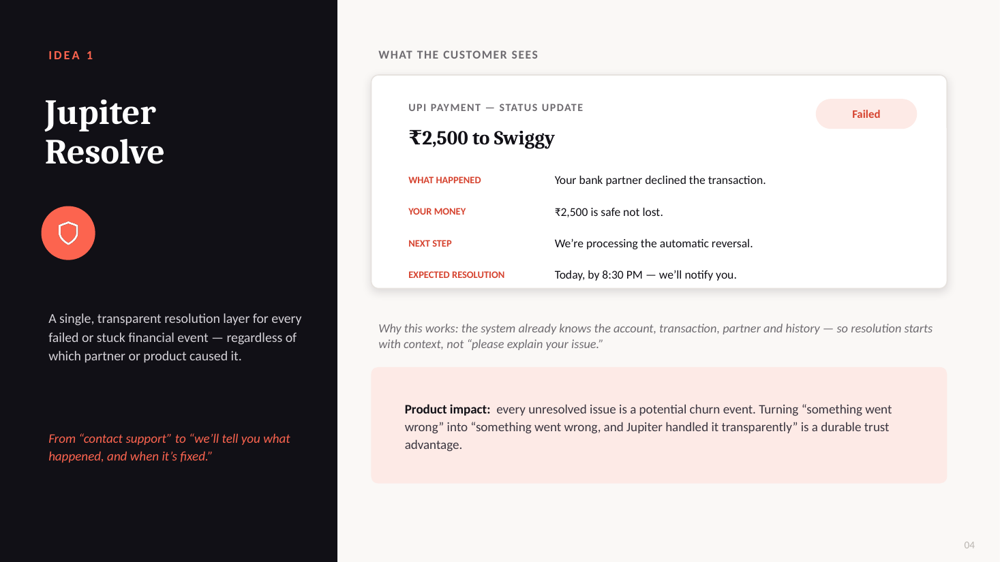
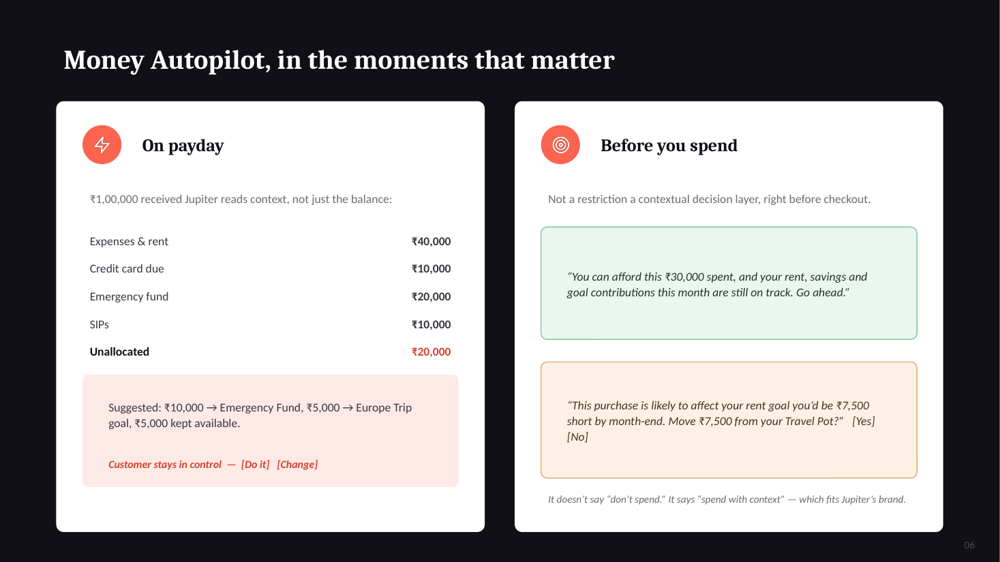

# Jupiter: From an App for Money to an Operating System for Money

*A self-directed product pitch. It's not affiliated with Jupiter and uses only the public app and public customer feedback.*

📄 [Full deck (PDF)](./jupiter_pitch.pdf) · [PowerPoint](./jupiter_pitch.pptx)

## The insight

Jupiter has already done the hard part: banking and UPI, goal-based Pots, investments and credit all live in one app. Public customer feedback points to a different gap. **When something breaks** (KYC, account opening, a Pot, a payment), the fix is scattered across bots, tickets and channels.

The customer's money passes through systems they never see: Jupiter → UPI → bank partner → card, investment or loan → support. All the customer says is *"My money isn't working. Fix it."* A broken streaming app is annoying. A banking app with stuck money causes fear. **Trust is the actual product.** So this is a product problem, not a support problem.

## Idea 1: Jupiter Resolve

One clear resolution layer for every failed or stuck transaction, whichever partner or product caused it. It moves the customer from "contact support" to "here's what happened, and when it will be fixed."

- **Why it works:** the system already knows the account, transaction, partner and history, so resolution starts with context instead of "please explain your issue".
- **Why it matters:** every unresolved issue is a potential churn event. Handling failure openly builds a trust advantage competitors can't easily copy.

## Idea 2: Money Autopilot

Jupiter already owns every building block of a customer's financial life. What's missing isn't another product. It's an **intelligence layer**, a "financial context engine", that connects the existing products across spending, saving, investing, borrowing and protection.

- **On payday:** it reads the context, not just the balance (rent, card due, emergency fund, SIPs), and suggests where the unallocated money should go. The customer stays in control: *Do it / Change*.
- **Before you spend:** it gives a contextual check, not a restriction. *"You can afford this, and your goals are still on track"*, or *"this leaves you ₹7,500 short on rent, so move it from your Travel Pot?"*

## The common thread

| | Role |
|---|---|
| **Jupiter Resolve** | Wins trust at the moment it's most likely to be lost: when something breaks |
| **Money Autopilot** | Builds a moat that only Jupiter's own data can power |
| **Together** | Reliable when things fail, proactive every day: the full "operating system for money" promise |

## How I'd measure it

- **Resolve:** resolution turnaround time, share of failed transactions resolved without a support ticket, churn after a failed transaction
- **Autopilot:** adoption (share of payday suggestions accepted), goal-completion rate, change in monthly active usage

## Skills shown

Product strategy · finding the real problem in customer feedback · UX for trust-critical moments · AI/personalisation product design · success metrics
